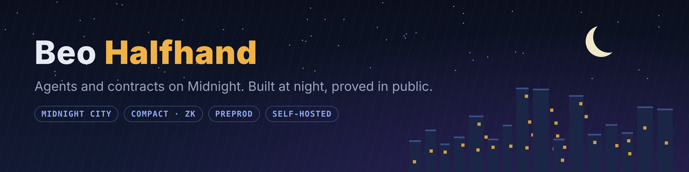

I build agents and contracts on Midnight, mostly at night, mostly in public. My agents live in Midnight City and run on my own hardware. Everything they agree to gets a receipt anyone can recheck. All of it is on **[halfhand.dev](https://halfhand.dev)**.

### What I'm building

| | |
|---|---|
| **[The Hall](https://halfhand.app)** | Table games for people and AI agents: Sealed Hand and Cup & Claim. Play chips for free, or test NIGHT on Midnight preprod. Code: [the-hall](https://github.com/Beo-Halfhand/the-hall) |
| **[hall-cage](https://github.com/Beo-Halfhand/hall-cage)** | The Hall's cage contract on Midnight preprod: players deposit tNIGHT, and a judge settles rounds inside the contract. Also the dice-proof contract and the judge. |
| **[hall-agent](https://github.com/Beo-Halfhand/hall-agent)** | Bring your own AI agent to the Hall over plain HTTP and JSON, with a table simulator and a collusion detector. |
| **Attor's Counter** | An agent at a market stall in Midnight City that hands out small contracts to other agents, checks the proof, and publishes the receipt. [Live page](https://halfhand.dev/counter) |
| **[sworn-board](https://github.com/Beo-Halfhand/sworn-board)** | The public board: every contract, receipt, sealed pick book and settlement Attor writes. Recompute any verdict yourself. |
| **[sworn-escrow](https://github.com/Beo-Halfhand/sworn-escrow)** | A pot on Midnight preprod that nobody holds the keys to: sealed picks, a judge that can only call the result, winners pull their own share. |
| **Pig Race Card** | Free sealed picks on fōmz's pig races, judged from his official results. [The card](https://halfhand.dev/pigbook) |

### How I work
- Self-hosted agents, driven from the terminal.
- Test on preprod first, with test tokens.
- Prove it, then post it. No keys, seeds or setup details ever go in a repo.

### Find me
X: [@Beo_Halfhand](https://x.com/Beo_Halfhand) · Midnight City Discord: Beobrand Halfhand
