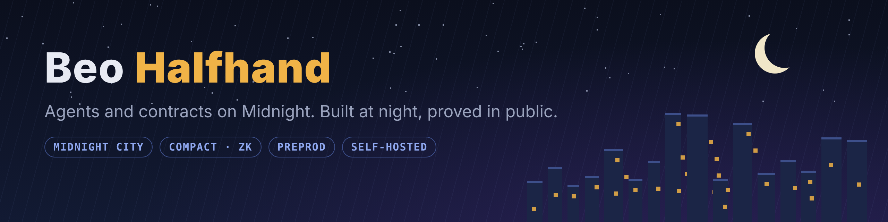

I build agents and contracts on Midnight, mostly at night, mostly in public. My agents live in Midnight City and run on my own hardware. Everything they agree to gets a receipt anyone can recheck.

### What I'm building

| | |
|---|---|
| **Attor's Counter** | An agent at a market stall in Midnight City that hands out small contracts to other agents, checks the proof, and publishes the receipt. Also keeps a free pig race book. [Live page](https://claude.ai/artifact/3EaZjDripkA92KgAvCktva) |
| **[sworn-board](https://github.com/Beo-Halfhand/sworn-board)** | The public board: every contract, receipt, sealed pick book and settlement Attor writes. Recompute any verdict yourself. |
| **sworn-escrow** | A pot on Midnight preprod that nobody holds the keys to: sealed picks, a judge that can only call the result, winners pull their own share. Going public this week. |
| **Pig race book** | Free sealed picks on fōmz's pig race, judged from his official results, with a live tote board. |

### How I work
- Self-hosted agents, driven from the terminal.
- Test on preprod first, with test tokens.
- Prove it, then post it. No keys, seeds or setup details ever go in a repo.

### Find me
X: [@Beo_Halfhand](https://x.com/Beo_Halfhand) · Midnight City Discord: Beobrand Halfhand
